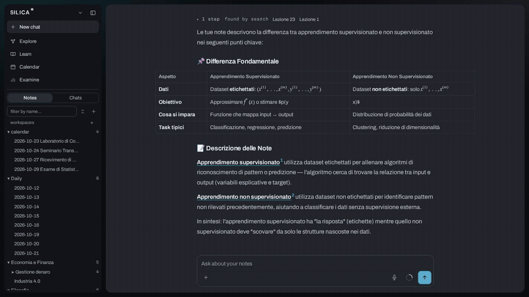
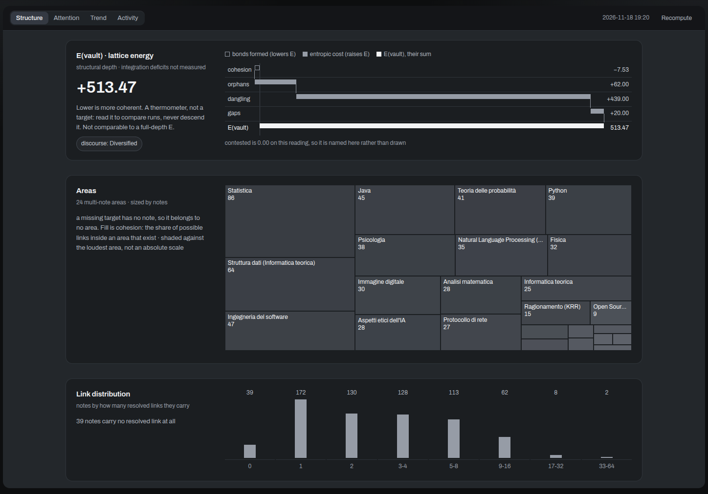
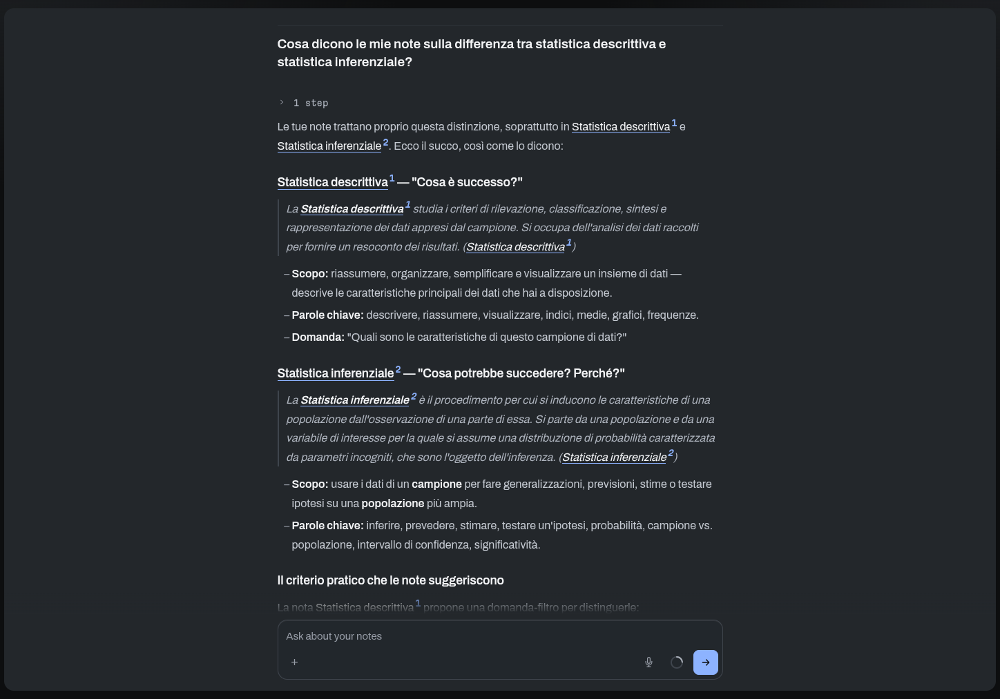
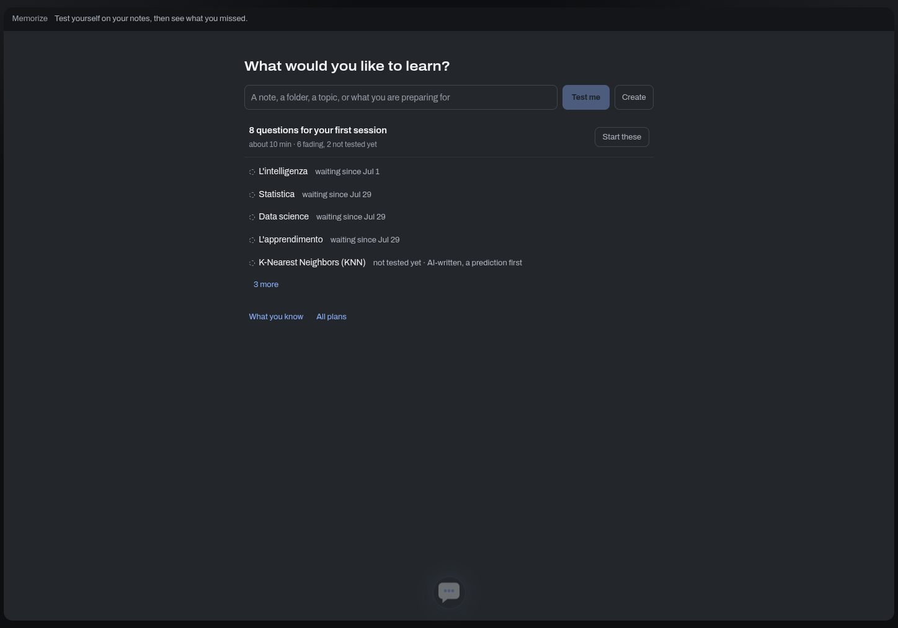
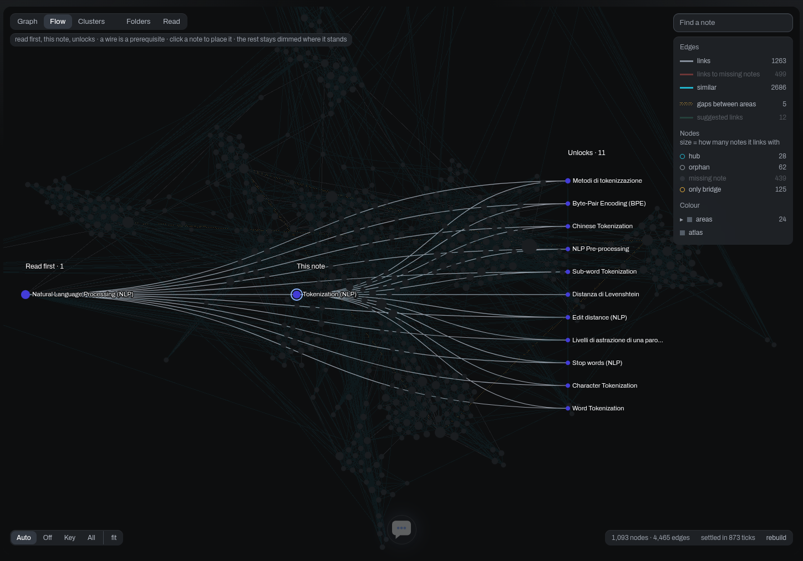
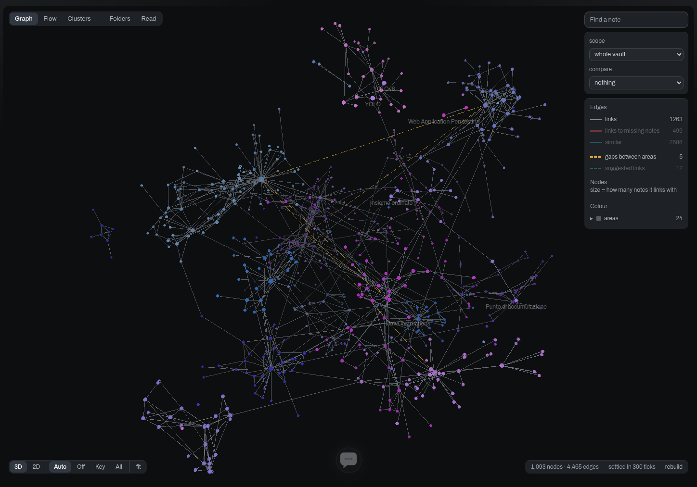

<p align="center">
  <picture>
    <source media="(prefers-color-scheme: dark)" srcset="https://raw.githubusercontent.com/kiycoh/silica-agent/main/assets/banner.svg" />
    
  </picture>
</p>

<p align="center">
  <b>Let an LLM read, write and organize your Markdown notes, and take back any edit it gets wrong.</b>
</p>

<p align="center">
  Point Silica at a folder of notes, PDFs or code. It answers from what is there, brings new material in,<br/>
  and checks every write it makes: parsed, validated, read back, and reverted if it does not hold.
</p>

<p align="center">
  <a href="https://pypi.org/project/silica-agent/"></a>
  <a href="https://github.com/kiycoh/silica-agent/blob/main/LICENSE"></a>
</p>

<p align="center">
  
  <br/>
  <sub>A real 748-note vault, written in Italian, so the answers are too: a question answered from the notes it found,<br/>
  then the vault as a graph, one note's reading path, the study queue, and the audit. Recorded with Qwen3.5-9B.</sub>
</p>

## Install

```bash
uv tool install "silica-agent[gui,mcp]"
```

Needs Python 3.11+ and [uv](https://docs.astral.sh/uv/). With pipx: `pipx install "silica-agent[gui,mcp]"`.

## Quickstart

```bash
cd ~/notes        # any folder of .md files, adopted as it is
silica init       # pick a model: a hosted API key, or a local LM Studio / Ollama model
silica --gui      # serves http://localhost:8765, open it in your browser; plain `silica` opens the terminal instead
```

Skipped `silica init`? With no model set, the web app walks you through choosing one: paste an OpenRouter key, or use LM Studio or Ollama found running on this computer.

Then type `/report`. It is read-only: it writes one file, `GRAPH_REPORT.md`, and shows the hubs, bridges and orphans already in your vault. Search and the graph work with no model at all.

<p align="center">
  
  <br/>
  <sub>The audit as a tab: what holds the vault together, the areas it sorts itself into, and how its links are spread.</sub>
</p>

## What you can do

Silica is single-user: one person, one vault. There are no per-person permissions and no vault shared between people.

**Bring documents in.** Slides, case files, papers and mail become notes in the source's own words, not a summary of them.

- `/nucleate Inbox/` takes a folder, a glob or one file (PDF, DOCX, EPUB, PPTX, notebooks). Each file is one transaction, checked against what you already have. Stop it whenever; it resumes.
- The vault's `+` imports files or a whole folder at the top of the vault, as they are, and a link into `Inbox/`, with no chat turn; move a folder into `Inbox/` and `/nucleate` it when you want it rewritten as notes. A YouTube link gives the video's transcript, a Reddit link the post and its top comments, and a GitHub link the repository's README, the file, or the issue or pull request with its comments (set `GITHUB_TOKEN` past GitHub's 60 reads an hour); `/fetch <url>` does the same from the chat. A file dropped on the chat stays that chat's until you press "add to vault".
- A long document is split at its headings into parts of at most 40,000 characters. A PDF page with no text, or with formulas its text layer loses, is read from its image by the model, up to 60 pages a file.
- A note keeps its source's DOI, arXiv id, authors and title, so it can be cited without reopening the document. With Zotero linked, a paper's note opens under its byline, with links to Zotero, the PDF and the DOI.
- `/mail import` keeps only the threads you took part in, from a mail client's export or Google Takeout, and writes nothing until `--apply`.
- In a git repository, `/wiki` writes an `ARCHITECTURE.md` plus a note per subsystem under `docs/silica/`, and `/stale` flags the notes whose code changed shape since.

**Ask, with the sources in view.** An answer comes from your notes and shows which ones; what they do not hold is labelled as general knowledge.

- `/explain`, `/compare`, `/summarize` and the chat answer from your notes and cite them. When the notes hold nothing on a question, the chat says so in one line, then answers from the model's own knowledge inside a block headed "From general knowledge, not your notes", never mixed into cited sentences. The line under the answer says "partly from general knowledge", and warns when that block came before any search of your notes. Commands and Memorize answer from the notes alone. Turn off Settings › Session › general knowledge (`SILICA_GENERAL_KNOWLEDGE=False`) for the strict chat: cited or refused. `/web` answers from the web, cited from the pages it actually opened.
- `/council "<question>"` puts one question to several models over one search of your notes. Each member answers from the same passages, with the same rules; the chat model then writes what they agree on, where they disagree and which member said what, every claim cited, with each member's own answer folded underneath. You name the members, 2 to 5, in `SILICA_COUNCIL_MODELS` or Settings › Brains; Silica picks none. A member that fails or runs out of time is named and skipped, and the line under the answer counts each member's calls and tokens. Not on the server in this version.
- `/page "<what>"` builds a self-contained HTML page from your notes into `Pages/`, or a small site in `Pages/<name>/`, its CSS and scripts inline, with a footer naming the notes it came from. It opens in the drawer or full window, in a sandbox with no access to the app, your session or the network; a page that tries to send its frame to another site is stopped there. A page's address opened in a browser tab of its own keeps the sandbox but not that last guard. Its write card reverts it, and "Revise this page: ..." in the chat writes a new version with a card of its own.
- Each cited note gets a number. Clicking it opens the note at the line closest to the paragraph that cites it, when enough of their words match; pointing at it lights every paragraph that cites the same note.
- A line under the answer counts the notes read, the steps and the seconds, and lists under "not cited" the notes it read and did not cite.
- A number in the answer that is in no note the chat read and in nothing you typed is listed under it: "numbers not in what this turn read".
- Each note `/nucleate` writes carries a `## Sources` block that leads to the source's verbatim copy in `sources/`. Passage search returns those copies, so a figure or a sentence can be checked in the source's own words; search by meaning and the graph leave them out, so there a source never competes with the notes made from it.
- Ask the last question again, or edit it. The chat also searches your earlier chats for what was asked and answered.

  
  <br/>
  <sub>Every claim links to the note it came from; a link with no note behind it says so.</sub>

**Study (Learn).** Questions on your notes, graded against the source each note rests on.

- `/memorize` and the Memorize tab ask ten kinds of question, from recall and cloze to transfer and contradiction, and correct you by quoting the source line the note rests on. When the note says more than its source, the answer reads "Source mismatch" and is not scored. `/quiz` re-tests what is fading, scheduled with FSRS-6.
- Before the reveal you say how sure you are: certain (90), pretty sure (70), half unsure (50), guessing (25), or skip. The grader never sees it, nor the session or the chat. Caps come after, in code: a hint or "Just tell me" caps the rating at Hard, and a right answer given while guessing caps at Good.
- A recall, fill-in, comparison or prediction can also be answered by choosing among four options: switch a session from "Answer by writing" to "Choose" (kept for the plan, or for the session), pick with 1 to 4, or run `/quiz --choice` in the terminal. The wrong options come with the question, a fill-in's from its own note, and each is checked in code: not the answer said again, not another option said again, not a phrase of the line the note rests on. A question without three that pass is asked in writing. A pick is graded by its key, with no model call: a wrong one is Again, a right one Good at most and Hard while guessing, and it never counts as met without help nor in Calibration. A missed pick comes back before the end on the same four in a new order.
- After 10 unassisted answers with a confidence, Calibration sets what you said against how often you met the criteria, level by level.
- "Explain it" closes the book: you explain a note in your own words, a student who has not read it asks 4 questions, and your explanation is then checked against the note and its source.
- No single score: estimated retention, depth (Facts, Parts, Mechanisms, New contexts), the relations you answered on and the misconceptions noted are shown apart. A note never asked counts as never practised, not as failed.
- 3 misses in a row on a note put a worked example from it one click away; it never appears unasked. A plan over a folder, some notes or a topic paces you to its date, and that day shows in the Calendar.

  
  <br/>
  <sub>Name what to learn, or start on the questions already waiting.</sub>

**See how notes connect.** The vault as a map: what sits together, what joins it, and what to read first.

- `/path "RAG" "Transformers"` walks the reading path between two notes over your wikilinks and the concept graph, `/relate` names the kind of each link, `/graph` and `/map` draw it.

  
  <br/>
  <sub>One note in its reading order, in the graph: what to read first, and what it unlocks.</sub>

- On the graph, a click makes a note the centre of its own map. In 2D the areas are an atlas: each note owns the ground nearest it, and zooming in names the sub-areas, then the notes.
- In Explore, Clusters gathers each area in one place on a ring, Flow puts one note in its reading order inside the graph, and Folders shades each folder by how much it mixes areas. Click a link to read the line it is written on. Read gives the whole vault a reading order from its hubs.
- Under a note's last line, the five notes nearest it by what they say, each with its similarity as a percentage: the cosine of the two notes' embeddings, not a probability. A similar note found only through shared concepts says so instead of showing a number.
- Compare one folder or area with another: the panel says what characterises each and quotes the links that join them.
- Click a concept to light the notes that treat it; a second concept narrows them to the notes that treat both, and the panel quotes the lines.

<p align="center">
  
  <br/>
  <sub>The same vault in 3D, coloured by the 24 areas it sorts itself into. A note's size is how many notes it links with.</sub>
</p>

**Trust what it writes.** Every write is checked, shown to you and reversible.

- Each write is a card in the chat with its revert. When the check is unsure, the card says why, shows the changed lines and asks you to keep or revert it.
- `/undo` one note, `/revert <run-id>` one run, `/revert --source paper.pdf` everything one document produced, however far it spread. A deleted note waits in the trash until you bring it back or delete it for good.
- When a new source contradicts a note, the contradiction stays written on the note until you resolve it; `/contested` lists them with their age; while one is open the dot on SILICA lights, and its menu lists them. `/contradictions` lists what the source checks found between your notes, without writing anything. The note's drawer sets both sides side by side, each opening at its line, and settles one in four ways: this note holds, the other holds, both hold under a condition you write, or keep it open. The outcome and its date stay in the note as text, and one undo takes back every note it touched.
- A flashcard whose answer is not in the note it cites is dropped before you see it; a slide point that is not in its note is named under the deck.
- `/verify` vouches for a note as you, bound to its text. `/stale` lists the notes whose source changed and the notes Silica wrote that were since edited by hand.

**Organise without moving files.** Files stay where you put them; Silica groups and remembers around them.

- A workspace is a note that gathers notes and folders from anywhere in the vault, by list, by folder or by a frontmatter value, plus the notes made from them. A chat opened in it searches only there and reads the workspace's text as standing instructions.
- Vault instructions, written once in Settings, are read by every chat over the vault.
- Silica keeps what a later chat will need and says so in the answer, unless the chat has brought in outside text such as a web page or a file. `/memory` shows what it holds, `/remember` saves your words as typed, `/incognito` keeps a chat off the record.
- The Calendar holds events, deadlines and the day each study plan is due; click or drag an empty time to add an event, with a reminder if you want one. `/agenda` lists a day or a week.
- A decision is a note: `/decide` writes your words to `Decisions/` with why you took it, what you expect and a day to review it; any note becomes one by gaining `decision: true`. `/outcome` adds what happened, dated, `/decisions` lists them, and the Calendar shows each on its review day and in its Decisions view, expected beside outcomes. Nothing judges one against the other but you.
- A request you make in 3 separate chats, never undone, becomes a proposed skill drafted from your own words. It runs only once you install it from Settings › Skills.
- `/curate` plans links, orphans and duplicates, a duplicate only once the worker model has judged the pair one (up to 20 verdicts a run, each remembered until a note of the pair changes), and `/aliases` proposes other names for note titles; both write only with `--apply`.
- What they propose waits in `/review`, with `/organize`'s dry runs, the writes the check refused and the notes whose code moved on. `/review apply` lands a selection as one run `/revert` takes back (`all` never takes an orphan or a duplicate, whose yes runs the worker model), `/review dismiss` forgets a proposal for good; Examine's Review row does the same with buttons.

**Write science notes by hand.** The editor needs no model for any of this.

- Formulas are LaTeX, and `$\ce{H2SO4}$` or `$\ce{2H2 + O2 -> 2H2O}$` writes chemistry as mhchem does; a ```` ```smiles ```` block draws the molecule, as Obsidian's Chem plugin reads it. Type a name in English or Italian inside a formula or a smiles block ("acido solforico", "pythagoras") and pick the formula or the molecule from the list; in a sentence the same list offers the formula inline, and Tab takes it (Enter stays a new line).
- A table is a grid: click a cell to edit it, Tab and Enter move on, and a bar adds or removes rows and columns. "As text" shows the Markdown.
- A pasted web address becomes a link named after its page. Pointing at a `[[link]]` shows the note it leads to.

## How a write is checked

<p align="center">
  
</p>

The model never touches a file. It proposes; a parser and a state machine decide.

| You already let a tool... | Silica does the same by... |
| :--- | :--- |
| a **compiler** reject source that does not build | refusing to commit a note that fails its structural checks |
| a **test suite** block a merge that breaks behavior | reverting any write that breaks the vault's links or structure |
| **git** roll back a bad commit | `/undo` and `/revert`, per note, per run, or per source document |

## Benchmarks

Every number comes from a committed result file in [`evals/`](https://github.com/kiycoh/silica-agent/tree/main/evals/), run on the product path.

| Measured | Result |
| :--- | :--- |
| LoCoMo, answerable questions | **82.1%** and **83.2%** accuracy (2 conversations, 302 questions) |
| LoCoMo, questions it should refuse | **87.2%** and **82.1%** correctly refused (87 questions) |
| Keeping the source's words vs summarizing, same pipeline | **+16.5** and **+14.7** points of accuracy |
| FActScore, facts in a written note its source supports | **0.961** to **0.999** across three write paths (5,855 facts) |
| Write integrity on a real 796-note Obsidian vault | **796 of 796** notes left with no new structural violation |
| MuSiQue multi-hop retrieval, 11,654-note vault | **61.3%** recall@10, **0.83** MRR |
| ViDoRe V3 page retrieval, 8 public sets: 189 PDFs, 19,252 pages, 2,419 human-judged questions | NDCG@10 **0.516** asked in the documents' language, **0.368** asked in Italian; the page vectors alone **0.531** and **0.500** |

Small samples, a flash-class judge, 2 of LoCoMo's 10 conversations: not comparable to vendor numbers, but re-runnable on your machine. ViDoRe V3 is the exception, scored as its paper scores it: on the same 8 sets and in the documents' language, the paper's text retrievers range from 0.458 to 0.549 and its best page-image model reaches 0.627. The unflattering rows ship too: `/organize` agrees with a human's folders 32% of the time, and on ViDoRe V3 the word index pulls Italian questions 13 points of NDCG@10, on average, under what the page vectors find alone, because the fusion does not yet step aside when a question's words are not in the documents.

## How it compares

Checked on 2026-11-08 against each product's own docs and release notes, and for Khoj and Reor their code. The columns are what people ask for most in these products' GitHub issues and in r/ObsidianMD and r/notebooklm, plus the two Silica is built on: checking a write and taking it back.

✅ yes · 🟡 partly, see the notes below · ❌ no: the vendor says so, or the code has none · ❔ not documented · ➖ does not apply

**What it is and where it runs**

| | Licence | Price | Local models | Your folder, in place | PDF, DOCX, EPUB, PPTX | Phone | MCP |
| :--- | :--- | :--- | :---: | :---: | :---: | :---: | :---: |
| **Silica** 0.31.1 | AGPL-3.0 or commercial | Free | ✅ | ✅ | ✅ | 🟡 | ✅ |
| **Obsidian Copilot** 4.0.18 | AGPL-3.0, closed hosted backend | Free; Plus $139.99/yr | ✅ | ✅ | 🟡 | 🟡 | ❔ |
| **Smart Connections** 4.7.2 | Source-available, not open source | Free; Pro $30/mo | 🟡 | ✅ | 🟡 | ✅ | 🟡 |
| **Khoj** 2.0.0-beta.28 | AGPL-3.0 | Free | ✅ | 🟡 | 🟡 | ✅ | 🟡 |
| **NotebookLM** | Proprietary | Free; paid from $4.99/mo | ❌ | ❌ | ✅ | ✅ | 🟡 |
| **Reor** 0.2.32, archived | AGPL-3.0 | Free | ✅ | ✅ | ❌ | ❌ | ❌ |

**How it answers and how it writes**

| | Answers only from your sources | A citation opens the passage | Ask only some sources | Edits your notes | Asks before an edit | Checks each write | Undo after it lands | Study with spaced repetition |
| :--- | :---: | :---: | :---: | :---: | :---: | :---: | :---: | :---: |
| **Silica** | ✅ | ✅ | ✅ | ✅ | 🟡 | ✅ | ✅ | ✅ |
| **Obsidian Copilot** | ❔ | 🟡 | 🟡 | ✅ | ✅ | ❔ | 🟡 | ❔ |
| **Smart Connections** | ➖ | ➖ | ➖ | 🟡 | 🟡 | ❔ | ❌ | ❔ |
| **Khoj** | 🟡 | 🟡 | 🟡 | 🟡 | ✅ | 🟡 | ❌ | ❌ |
| **NotebookLM** | 🟡 | ✅ | ✅ | ❌ | ➖ | ➖ | ➖ | 🟡 |
| **Reor** | ❌ | ❌ | ❔ | ✅ | 🟡 | ❌ | ❌ | ❌ |

Notes, by product:

- **Silica.** Phone: the web app at phone width, no native app. MCP: a client through `/connect`; the server is [silica-core](https://github.com/kiycoh/silica-core), a separate package. Asks before an edit: a write in the chat lands first, then a card to keep or revert it; it asks first only when its check is unsure, and bulk commands write only with `--apply`. Undo: per note, per run, or everything one source document produced. The hosted version is an invite-only pilot.
- **Obsidian Copilot.** PDF and EPUB are read through Miyo, a separate app, which semantic search also needs; Office files are read by the agent's own tools, not converted. Phone: chat and commands on Obsidian mobile; the agent is desktop only. A PDF citation opens the page; a note is only linked. A project's context guides the agent but does not confine it. Asks first in Safe mode; Auto mode skips most prompts. Undo: one turn on one note, until the note is edited again.
- **Smart Connections.** Local embeddings; local chat models only in the paid Smart Chat Pro. Notes only; PDFs and images through paid plugins. MCP: a server in the paid Connect Pro. The plugin has no chat: Smart Chat is a separate plugin. Edits only through the paid Connect Pro, whose proposal tools wait for review while its other write tools change notes directly. No undo: the vendor says to keep backups.
- **Khoj.** Self-host only since its cloud closed on 2026-04-15; Ollama and llama.cpp, not LM Studio. Your files are synced into Khoj's own database. PDF and DOCX, no EPUB or PPTX. MCP: a client, in research mode only. A `/notes` mode keeps answers to your notes, but with no matching note it answers anyway. A citation opens the note at its heading, in Obsidian. One file per filter. Edits in Obsidian only, previewed in the note before Apply; every edit target must be found or none applies, and nothing undoes it after Apply.
- **NotebookLM.** Renamed Gemini Notebook on 2026-07-16. Free up to 50 sources a notebook; sources are uploaded copies, and it never edits your files. MCP: a server in preview, to create notebooks and add sources only. Questions on the sources are refused when the sources do not hold the answer; the agentic chat can work without them. Flashcards and quizzes, with no review schedule documented.
- **Reor.** Archived on GitHub; last commit 2025-05-13. Asks before a write tool runs, with no diff. A citation opens the note, not the passage. Flashcards were removed after 0.2.26.

Where Silica is behind: no native phone app, no audio or video overviews, and a write in the chat lands before you see it, not after you approve it. Corrections are welcome.

## Use it from

| Where | Command |
| :--- | :--- |
| Browser | `silica --gui` |
| Terminal | `silica` |
| Obsidian desktop | `silica connect`, with the [obsidian-silica](https://github.com/kiycoh/obsidian-silica) plugin |

Coding agents (Claude Code, Codex, any MCP client) use [silica-core](https://github.com/kiycoh/silica-core), the retrieval engine Silica is built on, with no model in the loop.

<details>
<summary><b>All 69 commands</b></summary>

<br/>

**Workflow: the ones that plan, read widely, or write**

| Command | What it does |
| :--- | :--- |
| `/report [folder] [--top-k=N] [--embeddings]` | structural audit of the vault -> steering loop |
| `/nucleate <file...> [--target=DIR] [--hub=H]` | bring files in: notes via Injector FSM, code as skeleton stubs |
| `/promote [<key>]` | session memory -> a note: list what keeps recurring, promote one through the gate |
| `/web [keywords]` | answer from the web instead of the vault, cited; bare /web re-asks your last question |
| `/council "<question>"` | one search of the vault, the same question to 2 to 5 models of `SILICA_COUNCIL_MODELS`, and a cited synthesis of where they agree and disagree, each member's answer folded under it |
| `/organize "<intent>" [--scope=FOLDER] [--file=taxonomy.yaml] [--merge] [--move-uncategorized] [--apply]` | classify and reorganize vault notes according to a taxonomy |
| `/summarize <note|folder...>` | read-only digest of one or more notes in chat (key points, tables) |
| `/explain "<concept>" [--level=intro|expert]` | explain a concept grounded in the vault, at the chosen register |
| `/compare "<A>" "<B>" [...]` | comparison table of notes/concepts; surfaces contradictions |
| `/quiz [note|folder] [--n=10] [--choice]` | active-recall quiz; graded answers resurface the notes you miss. No target = review queue; `--choice` asks each question among four options |
| `/flashcards <note|folder> [--n=12] [--save=<path>]` | question-and-answer cards from the notes' checked points; `--save` writes them for the Spaced Repetition plugin |
| `/slides <note|folder> [--save=<path>]` | a slide deck of what the notes say; `--save` writes it for Obsidian's Slides |
| `/page "<what>"` | a self-contained HTML page, or a small site, built from the notes into `Pages/`; opens sandboxed in the app |
| `/memorize [plan] [--n=8] [--plan <name> --scope=<folder|note,note|topic:term> [--steps=<note>]] [--teach <note>] [--status [plan]]` | a study session graded against the source line, a plan note to continue or write, a teach-back, or the readings in one line; the Memorize tab is the same engine with a screen; `/learn`, its name before, still runs it |
| `/relate <note> [--n=8]` | typed relationship map: how/why one note relates to its vault neighbors |
| `/schematize <note|folder|topic> [--save=<path>]` | Markdown table schematizing a note, folder, or topic |
| `/diagram <note|folder|topic> [--save=<path>]` | Mermaid diagram of a note, folder, or topic |

`/summarize`, `/explain`, `/compare`, `/relate`, `/schematize` and `/diagram` are skills: one `SKILL.md` each, shipped in silica-core, in the [Agent Skills](https://agentskills.io) format with arguments filled the way Claude Code fills them (`$ARGUMENTS`, `$0`). Any folder holding a `SKILL.md` under `<vault>/.silica/skills/` (this vault) or `~/.silica/skills/` (every vault) becomes a command the same way, and one named like a built-in skill replaces it. Nothing in a skill folder is executed.

**Direct: one action, no agent loop**

| Command | What it does |
| :--- | :--- |
| `/episodes [--save=<path>]` | show what session memory holds: live chains, dated, grouped by key; writes nothing |
| `/remember [text]` | save your text as typed to this vault's memory, no model involved; bare, asks silica to keep what you just said |
| `/memory` | show what silica remembers about you and this vault, with file paths and budgets |
| `/agenda [today|week|YYYY-MM-DD]` | per-day merge of events, dated notes, agent activity and review due |
| `/decide <decision> [--why ...] [--expect ...] [--review YYYY-MM-DD] [--target DIR]` | write a decision as a note in Decisions/, as typed, no model involved |
| `/outcome <note> <what happened> [--status kept\|changed\|reversed]` | add a dated outcome to a decision note |
| `/decisions [open\|due\|all]` | list decision notes, those due for review first, with what was expected and the last outcome |
| `/convert <file...> [--target=DIR]` | transcode a non-.md file (PDF) into a markdown note in the inbox |
| `/web-search "<concept>" [--max-searches=N]` | research a concept on the web -> cited findings note in the Inbox (then /nucleate) |
| `/keep` | save the last /web answer as a cited note in the Inbox (then /nucleate) |
| `/fetch <url>` | read one URL (YouTube gives its transcript, Reddit its thread, GitHub its README, file or issue) -> verbatim note in the Inbox |
| `/status [run_id]` | progress digest of the last run |
| `/embed [folder] [--force]` | build/update embedding index |
| `/cooccur [folder] [--force]` | build/update co-occurrence index (without embedder) |
| `/lexical [folder] [--force]` | build/update lexical (BM25/fuzzy) index |
| `/wiki [folder|path] [--overview-only] [--force]` | behavioral code wiki: ARCHITECTURE.md + one note per subsystem |
| `/graph [out.html] [folder]` | export knowledge graph |
| `/map <note> [--force]` | radial mind-map rooted on a note -> maps/<stem>.canvas |
| `/find <query> [--k=N] [--min-trust=T] [--lifecycle=L]` | semantic search; the two epistemic flags filter after the search, so the count says what they cost |
| `/changes` | notes this session wrote to, with added/removed line counts |
| `/undo [note-path]` | undo the last patch on a note |
| `/delete <path>` | delete a note, even one other notes link to; says which links it left pointing nowhere, /undo brings it back |
| `/trash [restore <path> | erase <path> | empty]` | the notes deleted from this vault: bring one back, or delete for good |
| `/review [apply <id…\|kind\|all> \| dismiss <id…\|kind>]` | the review queue: refused writes, /curate, /aliases and /organize proposals and stale notes, accepted as one revertible run or dismissed for good |
| `/anneal [--steer] [--limit=N]` | retry every deferred bundle against the current vault; --steer escalates what still fails |
| `/revert [run-id | --source <file>]` | revert a whole run (bare: the newest; or the RUN id /status prints, whole or its first characters), or every run derived from one source |
| `/zotero [file|group|unlink|grant] [--apply|--yes]` | the linked Zotero library: status, file the inbox, write groups, unlink |
| `/mail [import <file.mbox|file.eml> [--label=X] [--me=ADDR] [--all] [--limit=N] [--apply]]` | mail threads you took part in, from a file you exported (a client's export or Google Takeout), kept as notes under `sources/mail/`; a dry run until `--apply`; bare, your addresses and imports so far |
| `/connect [list|add <json>|secure <key>|login <key>|logout <key>|remove <key>|reload]` | MCP servers Silica connects to, from `~/.silica/mcp.json` in Claude Code's shape: list them, add a pasted entry, move an inline secret to the keyring, log in to an HTTP server; each server is one loadable tool and every call it makes asks first |
| `/dedup [folder]` | deduplicate (sub-agent) |
| `/curate [folder] [--apply]` | curate the vault: plan autolink/orphan/dedup work (dry-run; --apply executes) |
| `/aliases [folder] [--apply]` | propose frontmatter aliases for note titles (abbreviations, spellings); dry-run, --apply writes |
| `/enrich [folder]` | add what lean notes are missing, as an appended section (sub-agent) |
| `/stale [--all] \| --stamp [folder] [--write]` | notes whose documents: sources changed structurally (--all includes cosmetic), attested notes whose body moved on, gate-written notes edited by hand; --stamp derives documents:/code_ref for unbound notes, --write stamps them |
| `/migrate [folder] [--write]` | notes Silica wrote in an older shape, rewritten through today's writer; a list until --write, then one revertible run |
| `/impact [<git-range>]` | changed files -> affected notes (documenting + 1-hop import neighbors); no range = uncommitted changes |
| `/plans` | list plans/ notes grouped by status: (todo\|in-progress\|blocked\|done) |
| `/path <noteA> <noteB>` | shortest reading path between two notes (wikilinks + co-occurrence) |
| `/contested` | list the open contradictions, each with its age and both sides; the app's note drawer settles them |
| `/contradictions [folder] [--check]` | contradictions the source checks found between notes, proposed and never written; --check first checks the notes never checked, 40 at a time |
| `/verify <note> [--clear] [--as "<name>"]` | vouch for a note as a person (OKF verified, bound to the body); --clear withdraws, --as signs with a name |
| `/check <note>` | read a note you wrote against the vault, block by block: what a source contradicts or overstates, links, identifiers, dates and quotations, by grade; never edits it. In the app, `check sources` in the note's menu underlines the text |

**Session and settings**

| Command | What it does |
| :--- | :--- |
| `/sessions [prune <days>d]` | list saved conversations (narration + legacy); prune deletes old ones |
| `/resume <n|id>` | reopen a saved conversation and continue it |
| `/new` | start a fresh conversation (same as /clear); the old one stays resumable |
| `/vault [path]` | show the active vault, or switch to another for this session |
| `/settings [<key> <value|none>]` | view or edit vault.yaml settings (language, tags) without the wizard |
| `/help` | show this help |
| `/model` | show the current LLM model |
| `/tools` | list registered tools |
| `/clear` | reset conversation history |
| `/verbose` | cycle tool progress: off -> new -> all -> verbose |
| `/thinking` | toggle display of the reasoning block |
| `/incognito` | toggle this session off the record: not captured, memory neither shown nor saved |
| `/persona [name\|off]` | the persona this conversation wears: list them, put one on, take it off. A persona is a skill whose frontmatter says `metadata: {persona: true}` |
| `/exit` | exit silica |

</details>

<details>
<summary><b>Docker, optional extras, configuration</b></summary>

<br/>

**Docker**

```bash
git clone https://github.com/kiycoh/silica-agent && cd silica-agent
SILICA_VAULT_HOST=~/notes docker compose up -d gui   # http://localhost:8765; your OPENROUTER_API_KEY passes through
```

**Extras**, combined like `"silica-agent[gui,mcp]"`: `gui` (web GUI), `mcp` (MCP client for `/connect`), `connect` (Obsidian bridge), `rerank` (local cross-encoder, pulls torch), `stt` (local dictation), `tables` (reads PDF tables as tables on this machine, weights downloaded on first use, with `SILICA_PDF_TABLES=1`), `youtube` (YouTube captions for `/fetch`, through yt-dlp), `all`. Scanned PDFs need OCR through [MinerU](https://github.com/opendatalab/MinerU), installed separately: `pip install 'mineru[full]'`, then `SILICA_PDF_PROVIDER=mineru`.

**Configuration** lives in `~/.silica/.env`, written by `silica init`; every variable and its default is in [`.env.example`](https://github.com/kiycoh/silica-agent/blob/main/.env.example). `silica doctor --live` checks the whole setup with one real request.

</details>

## License

[AGPL-3.0-or-later](https://github.com/kiycoh/silica-agent/blob/main/LICENSE). A [commercial license](https://github.com/kiycoh/silica-agent/blob/main/LICENSE-COMMERCIAL.md) covers proprietary embedding or a modified hosted service without releasing source. Contributing: [CONTRIBUTING.md](https://github.com/kiycoh/silica-agent/blob/main/CONTRIBUTING.md).
